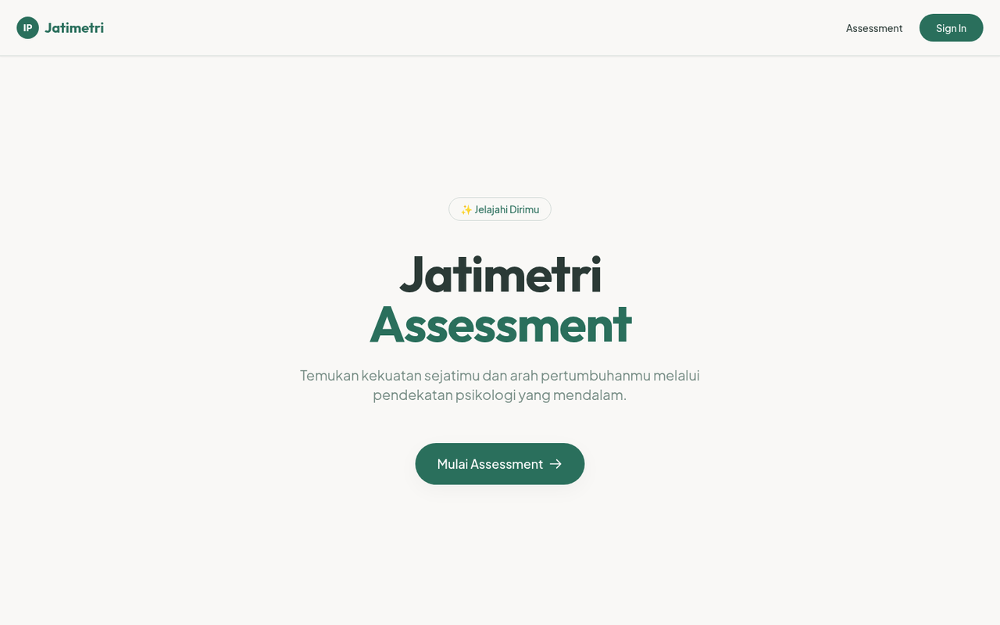

# Jatimetri Assessment Platform

**Live demo:** [jatimetri.belajarcarabelajar.com](https://jatimetri.belajarcarabelajar.com)



Jatimetri is a psychological assessment application designed to help users discover their true potential through an interactive assessment flow. It provides personal profiling, detailed reporting, and visual data representations using a modern React frontend and a serverless API backend.

## Architecture

The project is structured as a monorepo containing two primary layers:

- **Frontend (`/src`)**: A React Single Page Application built with Vite, TypeScript, TailwindCSS, and Shadcn UI. State is managed via Zustand, sign-in uses the BCB Academy unified login (only required for `/profile` and for saving reports; the assessment itself is anonymous), and reporting includes PDF generation and radar charts.
- **Backend (`/worker`)**: A Cloudflare Worker built with Hono and Drizzle ORM. It provides a secure API to save attempts, retrieve historical reports, and upload generated PDFs.

### Directory Structure

- `src/features/` - Core application feature modules (`assessment`, `dashboard`, `profile`, `pdf`).
- `src/components/` - Shared UI and layout components.
- `src/App.tsx` - Application routes (React Router).
- `src/data/` - Question bank (`questions/v1-bank.ts`) and scoring (`scoring/scoring-matrix.ts`).
- `worker/src/` - Worker entry (`index.ts`), app and routes (`app.ts`), BCB login receiver and sessions (`auth/`), database schema (`db/`); tests in `worker/test/`.

## Prerequisites

- [Bun](https://bun.sh/) (version pinned in `.bun-version`)
- [Node.js](https://nodejs.org/) 20.19+ or 22.12+ (required by Vite 8)
- A [Cloudflare](https://dash.cloudflare.com/) Account (for Workers, D1 Database, and R2 Storage)

## Environment Variables

Configuration is required for both the frontend and the backend.

### Frontend (`.env.local`, optional)
The frontend needs **no** environment variables. The API is called on the same origin as the SPA
(relative `/api/...` URLs), and it must stay there: the Worker is routed on `jatimetri.belajarcarabelajar.com`,
and the session cookie `__Host-jatimetri_sesi` is host-only and SameSite=Lax, so a cross-site API never receives
it, even though requests use `credentials: "include"`. `VITE_API_URL` is only for a same-origin path prefix or for
local development (see `.env.example`):
```env
# Default: same origin
# VITE_API_URL=
```

### Authentication (BCB Academy unified login)
There are no auth keys or tokens in the browser. Login works like this:

1. "Masuk" (or "Login & Simpan" on the dashboard) navigates the whole page to `/masuk-bcb/mulai?next=<current path>`.
2. The Worker sends the browser to the BCB Academy login at belajarcarabelajar.com, which hands back to the Worker's receiver.
3. The Worker sets an HttpOnly first-party session cookie on `jatimetri.belajarcarabelajar.com` and redirects to `next`.

The SPA reads the session from `GET /api/me` (`{ "email" }` or 401) through `useSession()` in `src/lib/auth`,
calls the API with `credentials: "include"` via `src/lib/api.ts`, and signs out with `POST /api/logout`.
"Hapus Data Jatimetri" on `/profile` (`DELETE /api/account`) deletes only the Jatimetri history and PDFs;
the BCB account itself is managed at [belajarcarabelajar.com/account](https://belajarcarabelajar.com/account).

### Backend (`.dev.vars`)
The Worker needs one secret, shared with the BCB apex (where it is called `SSO_RAHASIA_JATIMETRI`, program `jatimetri`
in `belajarcarabelajar/bcb` `packages/data/src/akun/sso-program.ts`). For local development create `.dev.vars`
next to `wrangler.toml`:
```env
# >= 32 characters; any value works locally
BCB_SSO_RAHASIA=change-me-local-only-0123456789abcdef
```
Without it, `/masuk-bcb` answers 503 (fail closed). The apex always hands back to the production origin, so a
real login only completes on `jatimetri.belajarcarabelajar.com`; locally the app runs signed out.

## Installation & Setup

1. **Install Frontend Dependencies**
   From the root of the project:
   ```bash
   bun install
   ```

2. **Install Backend Dependencies**
   Navigate to the worker directory and install its packages:
   ```bash
   cd worker
   bun install
   ```

3. **Configure Cloudflare Services**
   The backend relies on Cloudflare D1 and R2. Ensure `wrangler.toml` is updated with your specific IDs and bindings:
   - **D1 Database Binding:** `DB` (Database Name: `inner_potential_db`)
   - **R2 Bucket Binding:** `REPORTS_BUCKET` (Bucket Name: `jatimetri-reports`)

## Development

You need to run both the frontend and the backend simultaneously for full local functionality.

**Start the Backend (API)**
Open a terminal in the root directory (where `wrangler.toml` lives) and start the local Cloudflare dev server (wrangler is a root devDependency; the worker's own dependencies come from `worker/`, so install both first):
```bash
bun run worker:dev
```
The API only answers CORS requests from `https://jatimetri.belajarcarabelajar.com`, `http://localhost:5173` (Vite dev) and `http://localhost:4173` (Vite preview). To allow more origins (e.g. a Pages preview URL), set `ALLOWED_ORIGINS` to a comma-separated list in `.dev.vars` locally or as a worker variable/secret in production. CORS does not carry the session cookie: from another site the API only answers as signed out.

**Start the Frontend**
Open a separate terminal in the root directory and start Vite:
```bash
bun run dev
```
The Vite dev server proxies `/api` and `/masuk-bcb` to `http://localhost:8787`, so the SPA and the Worker share one origin (and the session cookie) in development too. Without the Worker running, the app still works and simply shows the signed-out state.

## Testing

The frontend uses Vitest for testing. Run the following commands from the root directory:

- Run all tests: `bun run test`
- Run tests in watch mode: `bun run test:watch`
- Generate test coverage: `bun run test:coverage` (CI enforces the thresholds in `vitest.config.ts`)
- Lint: `bun run lint`
- Worker (BCB login receiver, sessions, API; Bun + in-memory SQLite): `bun run worker:test`
- Worker type-check: `bun run worker:typecheck`

## Build & Deployment

### Frontend
To build the frontend for production:
```bash
bun run build
```
To preview the production build locally:
```bash
bun run preview
```
To build and deploy to Cloudflare Pages (project `jatimetri`):
```bash
./scripts/deploy-website.sh
```
Set `SKIP_BUILD=1` to deploy the existing `dist/`. CI does not deploy automatically.

### Backend (API)
The Worker is routed on the same host as the Pages site (`jatimetri.belajarcarabelajar.com/api/*` and
`/masuk-bcb*`, see `routes` in `wrangler.toml`). First-time setup / after schema changes (run from the root, after `wrangler login`):
```bash
bunx wrangler d1 execute inner_potential_db --remote --file worker/drizzle/0001_bcb_sso.sql
bunx wrangler secret put BCB_SSO_RAHASIA   # same value as SSO_RAHASIA_JATIMETRI on the BCB apex
```
Then deploy:
```bash
bun run worker:deploy
```
